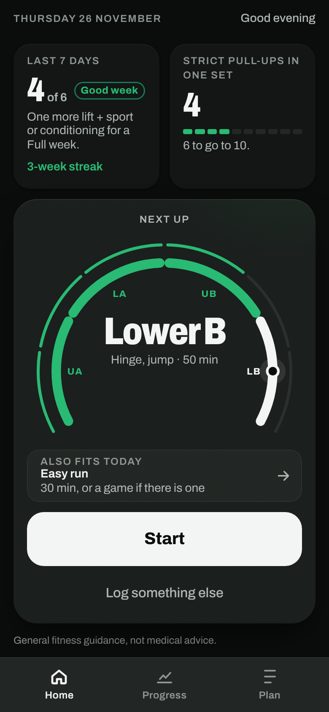
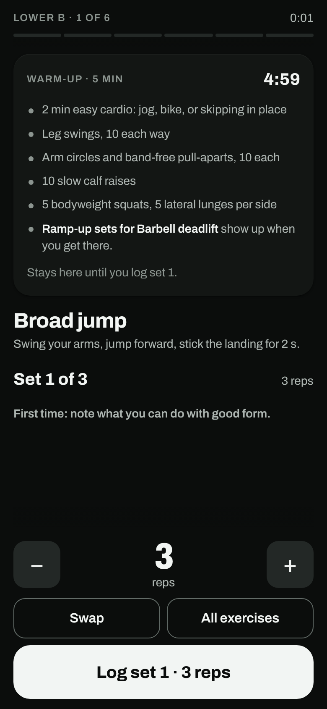
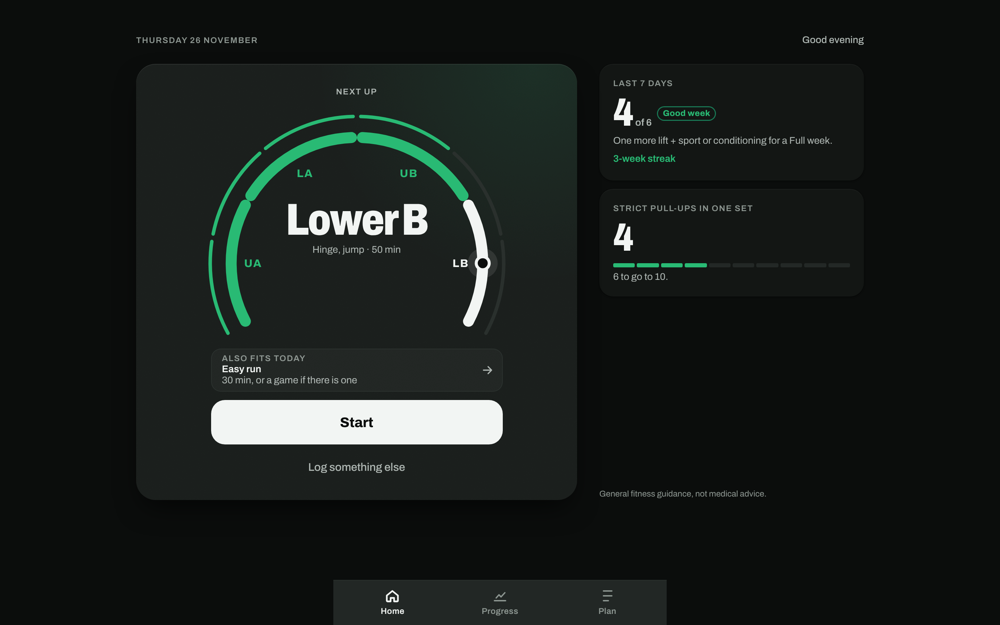

# Uptime

A training app that tells you the next session to do and lets you start it in one tap. Live at **https://harshmimani.github.io/uptime/**

## Screenshots

| Home (mobile) | Workout (mobile) |
|---|---|
|  |  |

Screenshots use demo data.

## The idea

The routine is a rotation, not a calendar. One cycle has 4 strength sessions (Upper A → Lower A → Upper B → Lower B), 1 run and 1 sport or conditioning session. A missed day never skips anything, because the app just shows the next session in line. Progress is counted over a rolling 7 days, and a busy week that still hits the minimum keeps the streak going. It's built to keep training consistent through a busy, irregular schedule.

## How it was built

- **Harsh (me):** product owner. Defined the goals and requirements, reviewed every plan and design, and tested on my phone.
- **Claude (claude.ai):** helped shape the requirements and wrote the prompt sequence.
- **Claude Code:** audited the old version, wrote the `CLAUDE.md` rulebook, designed the training plan with me, and built, tested and optimised the app.
- **GitHub** for version control, **GitHub Pages** for hosting.

## Tech and performance

- Plain HTML, CSS and JavaScript (ES modules). No framework, no build step, no dependencies in the app.
- The whole plan lives in one data file (`js/plan.js`). Logs are stored on the device in versioned local storage with backups and JSON export.
- **Offline and installable (PWA):** a service worker caches each release, a web manifest makes it installable, and a "New version, tap to refresh" prompt never appears mid-workout.
- View Transitions API for the Start-to-Workout morph. On desktop, a small canvas effect is lazy-loaded and never downloads on phones.
- Tests: Node's built-in test runner (`npm test`) and Playwright + Chromium browser checks (`tests/browser/`).
- All JavaScript together is about 80 KB gzipped, against a 150 KB budget.

Lighthouse 12, mobile preset (slow 4G, 4× CPU slowdown):

| Page | Performance | Accessibility | Best practices | SEO |
|---|---|---|---|---|
| Home | 99 | 100 | 100 | 90 |
| Workout | 100 | 100 | 100 | 100 |
| Progress | 100 | 100 | 100 | 100 |
| Plan | 100 | 100 | 100 | 100 |

---

General fitness guidance, not medical advice.
