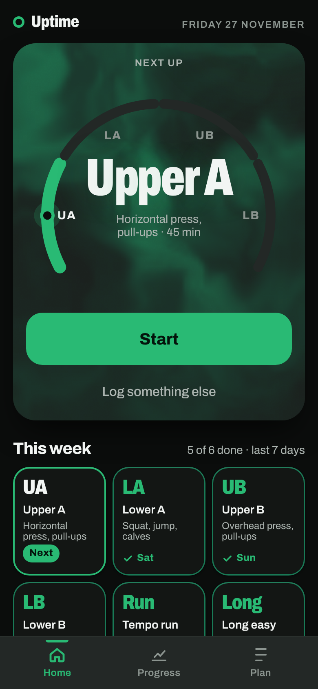
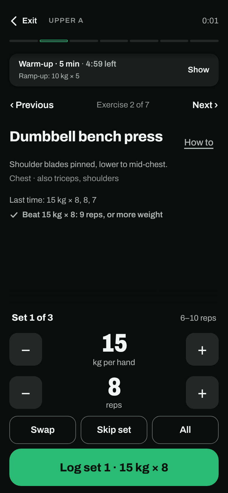
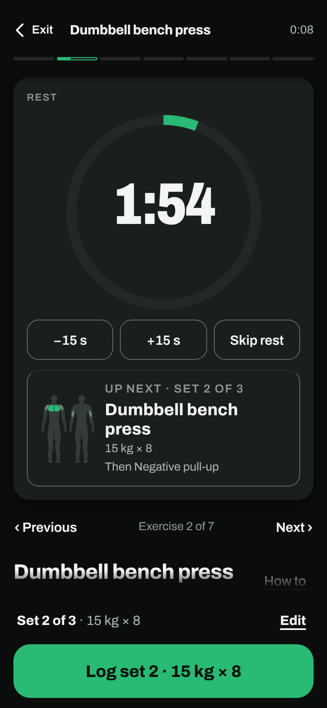
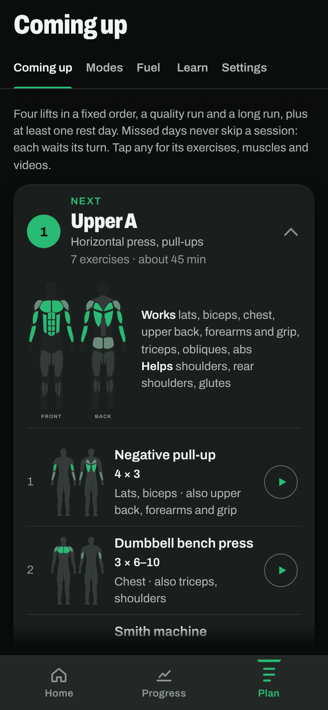
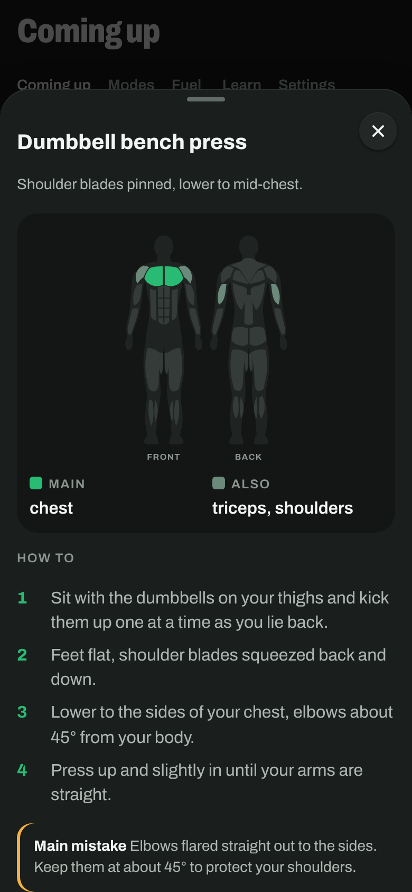
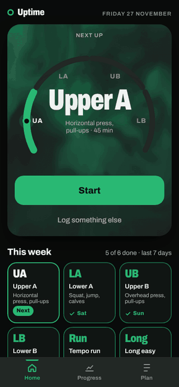
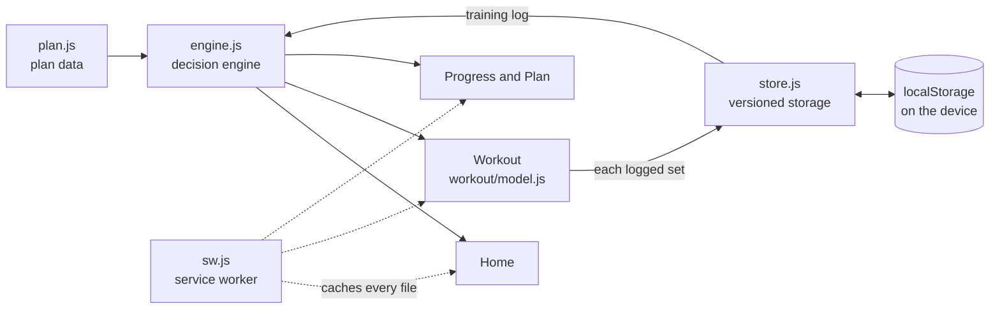
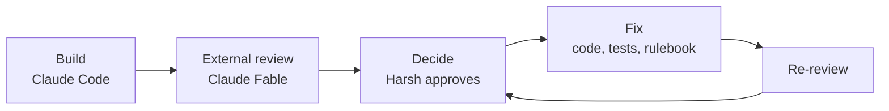

# Uptime

A strength-and-running app that always knows the next session to do, built around a rotation instead of a calendar.

**Live:** https://harshmimani.github.io/uptime/ (installable, works offline)

- **What it is:** a phone-first training app for 4 strength sessions, 2 runs and basketball per cycle. It shows the next session, starts it in one tap and logs each set in one tap.
- **What's clever about it:** a rule-based decision engine. Pure functions of the training log decide what's next, how heavy, when to back off and what counts as a good week. Missed days never break the plan.
- **How it was built:** human-in-the-loop with AI. I owned the product and approved every decision. Claude Code built and tested it against a written rulebook ([`CLAUDE.md`](CLAUDE.md)), and independent AI reviews scored each round.

| Home | A set | Rest | Coming up | How-to |
|---|---|---|---|---|
|  |  |  |  |  |



<sub>Demo data, phone size (390 × 844), dark theme. A light theme follows the phone setting.</sub>

## The problem and the idea

Most training plans are calendars: Monday legs, Wednesday push. The first busy week breaks the calendar, and a broken plan is usually how people quit. For a student moving into full-time work, the real risk is stopping, not training too little.

Uptime replaces the calendar with a **rotation**: Upper A → Lower A → Upper B → Lower B, plus a quality run and a long run. A missed day never skips a session; the next one simply waits. Progress is counted over a rolling 7 days rather than Monday to Sunday, and a busy week that still reaches the Minimum level keeps the streak alive. The plan follows the user's life instead of the other way round.

## Architecture

Static, local-first web app. All data stays on the device in `localStorage`. There is no server, no account and no analytics, so nothing personal leaves the phone (privacy by design).



| Part | What it does |
|---|---|
| `js/plan.js` | The single source of plan content: 118 exercises with how-to guides, 9 sessions, the pull-up ladder, run rules and the numbers the engine reads. The UI never hard-codes plan content. |
| `js/engine.js` | Pure functions of (log, settings, today). No DOM, storage or clock, so every decision is deterministic and unit-tested. |
| `js/workout/` | The workout in progress: prefill, double progression, rest timer from end timestamps, partial saves, run targets. |
| `js/store.js` | One record in `localStorage`, schema version 4. Migrations from every earlier version and app, a backup copy before each migration or import, and JSON export and import. |
| `index.html`, `workout.html`, `progress.html`, `plan.html` | Home, the full-screen Workout, Progress and Plan, each a plain ES module page. |
| `sw.js` | Offline-first service worker: one versioned cache per release, and a "New version" prompt that never appears mid-workout. |

## The decision engine

The engine is **rule-based and formula-based**. Every rule is written in `CLAUDE.md`, mirrored as numbers in `plan.js` and covered by tests.

| Decision | Rule in the code |
|---|---|
| Next session | The one after the last done, in rotation order. Nothing is ever skipped or stacked. |
| Week level | Over the rolling 7 days: **Full** = 4 lifts + quality run + long run (or other conditioning); **Good** = 3 lifts + 1 cardio; **Minimum** = 2 lifts. |
| Streak | Consecutive 7-day blocks that reach at least Minimum, counted from the first session. |
| Progression | Double progression: when every set hits the top of the rep range, add the smallest jump (2.5 kg on lower-body main lifts, 1–2.5 kg upper, next dumbbell). |
| Stall | 2 comparable sessions in a row with no gain: suggest a ~10% reset. |
| Deload | Every 6 weeks (overdue at 8), or after 3 Rough check-ins in one rotation: about half the sets. Skipped if 2 of the 6 weeks before were already light. |
| Return after a gap | 7–13 days off: first session at 90%. 14+ days: first week at 80% with one set fewer. |
| Spacing | Suggestions, never blocks: no Lower right after a hard run or game, no intervals or basketball the day after Lower B, avoid 3 hard days in a row. |

<details>
<summary><b>Derived metrics and formulas</b> (each one is in the code)</summary>

| Metric | Formula / rule | Where |
|---|---|---|
| Rolling week | Counts over the 7 days ending today, never Mon–Sun | `windowStats` |
| 5K-equivalent | `T5 = T × (5 / d) ^ 1.06` from any typed time line (Riegel) | `riegel`, `fiveKSec` |
| Training paces | tempo = 5K pace + 15 s/km; easy = 5K pace + 75–100 s/km | `paces` |
| Half-marathon pace | Riegel's 21K pace as a ceiling, shown as a range up to 15 s/km slower | `runTarget` |
| Long run | `next = min(last + 1 km, floor_0.5km(1.10 × longest in last 30 days))`, capped | `longRunKm` |
| Long-run cap | `clamp(floor(70 min / easy pace), 10, 12)` km in normal weeks | `longCapKm` |
| Interval reps | 4 × 800 m, +1 rep every 2nd session up to 6; 31–60 days off: −1 rep; over 60: back to 4 | `intervalReps` |
| Game limit | A game replaces the quality run at most 2 rotations in a row | `gamesInRow` |
| Dumbbell rep range | By load per hand: ≤10 kg 8–15, 12.5–17.5 kg 6–10, ≥20 kg 5–8 | `repRange` |
| "Beat last time" | Heavier wins; at equal weight, more reps (or seconds). "New best" when no earlier set is as good | `beats`, `rewardFor` |
| Partial session | Counts only if logged sets ≥ half of planned | `isStubCount` |
| Bodyweight trend | Mean of each 7-day block that has a weigh-in | `weeklyWeight` |
| Protein target | 1.6–2.0 g per kg, rounded to 5 g | `proteinTarget` |
| Session length | Work + rest per round + changeovers + warm-up, rounded to 5 min | `estimateMin` |

An estimated one-rep max is **not** computed anywhere; progress is tracked as top sets and total reps.

</details>

<details>
<summary><b>Data model</b> (what is stored, on the device only)</summary>

| Record | Fields |
|---|---|
| Session | `id`, `date`, `t` (start), `end`, `session` (UA, LA…), `checkIn` (Good / Okay / Rough), flags (`short`, `deload`, `reduced`, `partial`, `noGym`), `planned` sets, `items` |
| Item | `ex` (exercise id), `role` (main, accessory, jump, carry, core), `sets` |
| Set | `t`, `kg`, `reps` or `sec` (weights always stored in kg) |
| Activity | `kind` (run, sport, conditioning), `run` (tempo, interval, long, easy), `km`, optional time line |
| Settings | Busy-mode log, deload dates, ladder level, race (distance and date), units (the theme is a separate per-device key) |

Backups: `uptime-backup-v<n>` before each migration, `uptime-backup-last` before an import or reset. Logs are never deleted.

</details>

### Why rules, not ML (yet)

There is one user and a few sessions a week. A learned model would overfit that sparse data and couldn't be validated honestly. Rules from exercise science are explainable ("every set hit 10, so +2.5 kg") and safe at the edges. They also work on day one with no training data.

**Future ML ideas (not built):**
- **Personalised progression:** learn each lift's rate of gain from logged sets (weight, reps, dates) to tune the jump size and stall threshold.
- **Readiness scoring:** predict a Rough session from check-ins, recent load and gaps between sessions.
- **Missed-session prediction:** use session dates, weekdays and Busy-mode history to suggest the best slot before a week slips.
- **Pace prediction:** fit the Riegel exponent to my own typed race times instead of the population 1.06.

## How it was built with AI

| Role | Who | Did what |
|---|---|---|
| Product owner | Harsh (me) | Set the goals and requirements, approved every decision, tested in real workouts |
| Requirements | Claude (claude.ai) | Shaped the requirements and designed the prompts |
| Builder | Claude Code | Wrote the `CLAUDE.md` rulebook, then built, tested and optimised the app |
| Reviewer | Claude Fable | Independent reviews as a senior coach and a senior product designer |



| Review score (out of 10) | First review | Follow-up review |
|---|---|---|
| Training plan | 6.5 | 8.5 |
| Look and feel | 7 | 8 |
| Ease of use | 6 | 8 |
| Fun | 5 | 7 |

The follow-up reviews' own findings (5 training changes and 12 app fixes) are applied and live but have not been re-scored yet.

## Quality and performance

| Check | Result |
|---|---|
| Unit tests | 178 tests in 11 files (`npm test`, Node's test runner), all passing |
| Browser checks | 702 of 704 Playwright assertions pass across 6 scripts in `tests/browser/`, at 360 px, 390 px and desktop widths. The 2 misses: the first-visit budget below, and an intermittent timing check on the how-to sheet at 360 px |
| Lighthouse 12.8 mobile | Accessibility 100 and Best practices 100 on all four pages. Performance: Progress 98, Plan 98, Workout 96, Home 85–91 |
| JavaScript per page | 91–124 KB gzipped, against a 150 KB budget |
| First visit, slow 4G | 1.51–1.64 s across runs in a cloud test container, just over the 1.5 s budget; 0.19–0.32 s once installed |
| Offline | Every page works offline after the first visit (checked with the network cut) |
| Contrast | Every colour pair checked for WCAG 2.2 AA in both themes (`tests/contrast.test.js`) |
| Session length | Every session checked against its 50-minute cap (Short version: 30) at every ladder level (`tests/timecheck.test.js`) |

<details>
<summary>How these were measured</summary>

Measured on 27 Nov 2026 in a 4-core cloud container, with the site served gzipped as GitHub Pages serves it. Lighthouse used its default mobile preset (simulated slow 4G, 4× CPU slowdown). Home's performance varies between runs, and the version before the latest changes gives the same spread. Its blocking time comes from compiling the WebGL background shader (`js/field.js`), which loads after the page is idle and never delays the Start button. JS size is the sum of each loaded script, gzipped, after 4 seconds on the page. The first-visit time comes from `tests/browser/check-home.mjs`.

</details>

## Tech stack and running it locally

Plain HTML, CSS and JavaScript (ES modules) with no framework, no build step and no runtime dependencies. View Transitions API for the Start-to-Workout morph, SVG for the muscle maps, a small WebGL shader for Home's background. Tests use Node's built-in test runner and Playwright with Chromium. Hosted on GitHub Pages.

```bash
npm test
```

```bash
python3 -m http.server 8000
```

Then open http://localhost:8000/. Browser checks run with `npm run check:workout`, `check:pages`, `check:home`, `check:nav`, `check:offline` and `check:style`; they need Playwright with Chromium.

---

General fitness guidance, not medical advice.
